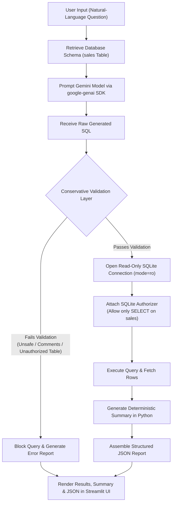

# GenAI Text-to-SQL Agent with Query Validation & Structured JSON Reporting

A lightweight, secure, and production-disciplined Generative AI practical project that converts natural-language business questions into validated SQLite queries using the official **Google GenAI SDK**, executes safe queries against an SQLite database in read-only mode with low-level authorizer enforcement, and produces a structured JSON report.

---

## 1. Project Overview

The **GenAI Text-to-SQL Agent** demonstrates an end-to-end pipeline for querying relational databases using plain English without requiring manual SQL coding. Unlike naive Text-to-SQL implementations that directly run LLM-generated code against live databases, this agent implements a **defense-in-depth security model**:
- Generated SQL is inspected and validated before execution.
- Execution is strictly read-only and governed by an SQLite authorizer.
- A deterministic Python summarizer generates instant insights without additional LLM latency.
- The pipeline outputs a standardized JSON payload consumable by APIs, dashboards, and end-users.

---

## 2. Problem Statement

> **Problem Statement 54:** Create a Text-to-SQL agent that validates generated SQL queries before execution and produces a structured JSON report containing query, result, and summary.

Organizations need non-technical stakeholders to query internal databases securely. However, executing unvalidated LLM-generated SQL risks data corruption, accidental deletion, unauthorized data exposure, and SQL injection vulnerabilities. This project solves that problem by enforcing conservative pre-execution validation, engine-level read-only constraints, and structured, audit-ready JSON reporting.

---

## 3. Objectives

- **Natural Language Understanding**: Convert plain English questions into precise SQLite `SELECT` queries using Google Gemini.
- **Strict Query Validation**: Enforce conservative security rules rejecting data modification, schema alterations, SQL comments, multiple statements, and unauthorized table access.
- **Engine-Level Security**: Execute queries exclusively via read-only SQLite connections with a database authorizer denying any table other than `sales`.
- **Deterministic Summarization**: Compute descriptive summaries deterministically in Python to minimize response time and eliminate redundant LLM calls.
- **Standardized JSON Reporting**: Deliver consistent JSON reports containing `question`, `query`, `result`, `summary`, `status`, and `error`.
- **User-Friendly Interface**: Provide an intuitive Streamlit UI featuring example queries, database schema inspection, live table preview, and security testing presets.

---

## 4. Technologies Used

| Technology | Purpose |
| :--- | :--- |
| **Python 3.10+** | Core programming language for the agent and pipeline. |
| **Google Gemini API** | State-of-the-art LLM for natural-language to SQL translation using the official `google-genai` Python SDK. |
| **SQLite (`sqlite3`)** | Lightweight, file-based relational database engine with built-in authorizer hooks and URI read-only support. |
| **Streamlit** | Interactive, clean web interface for business users and testing. |
| **JSON (`json`)** | Standardized payload interchange format for reporting and programmatic consumption. |
| **python-dotenv** | Secure management of configuration and environment variables. |

> **Zero Bloat Policy**: No heavy orchestration frameworks (e.g., LangChain, LangGraph), vector databases, or complex external dependencies.

---

## 5. System Workflow

The following flowchart outlines the end-to-end processing pipeline:



### Detailed Pipeline Stages

1. **Schema Extraction**: Reads column names (`id`, `product`, `quantity`, `price`) and calculation rules (`quantity * price` for total sales).
2. **SQL Generation**: Sends a strict prompt instructing Gemini to return raw SQLite SQL only, with no markdown code fences, notes, or explanations.
3. **Pre-Execution Validation**: Checks syntax, disallows multi-statement semicolons, rejects comments (`--`, `/*`, `#`), verifies query begins with `SELECT`, and restricts table references strictly to `sales`.
4. **Authorizer & Execution**: Opens `file:sales.db?mode=ro` with `conn.set_authorizer(...)`. Returns rows formatted as a list of Python dictionaries.
5. **Deterministic Summarization**: Analyzes row count, leading products, and numerical metrics to generate an accurate summary.
6. **JSON Report Output**: Returns a complete dictionary rendered in the Streamlit UI and expandable JSON inspector.

---

## 6. Project Folder Structure

```text
text_to_sql_agent/
│
├── app.py                # Streamlit web application & user interface
├── database.py           # SQLite initialization, seeding & schema management
├── agent.py              # Core pipeline: generation, validation, execution & summary
├── test_agent.py         # Automated test suite covering the 6 validation scenarios
├── requirements.txt      # Minimal dependency manifest
├── .env.example          # Environment variable template (no credentials)
├── .gitignore            # Git exclusion rules (.env, venv/, sales.db, __pycache__)
├── README.md             # Project documentation and execution instructions
└── sales.db              # SQLite database (created and seeded automatically)
```

---

## 7. Installation Instructions for Windows

Follow these steps using **Windows PowerShell**:

### Step 1: Open the Project Directory
```powershell
cd text_to_sql_agent
```

### Step 2: Create and Activate a Virtual Environment
```powershell
# Create virtual environment
python -m venv venv

# Activate virtual environment
.\venv\Scripts\Activate.ps1
```
*(If script execution is blocked on your system, enable it temporarily by running: `Set-ExecutionPolicy -ExecutionPolicy RemoteSigned -Scope Process`)*

### Step 3: Install Required Dependencies
```powershell
pip install -r requirements.txt
```

---

## 8. Configuring the Gemini API Key Using `.env`

### Step 1: Copy the Template
```powershell
Copy-Item .env.example .env
```

### Step 2: Add Your Credentials
Open `.env` in any text editor (e.g., VS Code or Notepad) and set your API key:

```env
GEMINI_API_KEY=your_gemini_api_key_here
GEMINI_MODEL=gemini-2.5-flash
```

> **Security Note**: Never commit your `.env` file to version control. The `.gitignore` file is configured to exclude `.env` automatically.

---

## 9. How to Run the Application

### 1. Run Automated Tests
Before starting the web UI, verify that all security checks, database operations, and pipelines are operating properly:

```powershell
python test_agent.py
```

### 2. Start the Streamlit Web Application
```powershell
streamlit run app.py
```

Streamlit will launch local server and open your default browser (typically at `http://localhost:8501`).

> **Automatic Database Seeding**: `sales.db` is initialized and populated with sample records automatically on application launch. No manual database setup is necessary.

---

## 10. Sample Natural-Language Queries

Try these example questions in the application:

1. **Product Catalog & Pricing**:
   - `"Show all products and their prices."`
   - *Expected SQL*: `SELECT product, price FROM sales;`
2. **Top Revenue Products (Aggregation)**:
   - `"Show the top three products by total sales."`
   - *Expected SQL*: `SELECT product, SUM(quantity * price) AS total_sales FROM sales GROUP BY product ORDER BY total_sales DESC LIMIT 3;`
3. **Inventory & Quantities**:
   - `"What is the total quantity of items sold?"`
   - *Expected SQL*: `SELECT SUM(quantity) AS total_quantity FROM sales;`
4. **Total Business Revenue**:
   - `"What is the total revenue generated from all sales?"`
   - *Expected SQL*: `SELECT SUM(quantity * price) AS total_revenue FROM sales;`
5. **Price Ordering**:
   - `"Show products ordered from highest to lowest price."`
   - *Expected SQL*: `SELECT product, price FROM sales ORDER BY price DESC;`

---

## 11. SQL Validation & Security Features

The agent deploys a **triple-layer defensive architecture** to guarantee safe execution:

```
+--------------------------------------------------------------------------+
| Layer 1: Static Pre-Execution Validator (Python Regex & Tokenizer)      |
| - Rejects non-SELECT queries (INSERT, UPDATE, DELETE, DROP, ALTER, etc.) |
| - Rejects SQL comments (--, /* */, #) to prevent injection bypasses      |
| - Rejects multi-statement execution (semicolon chaining)                 |
| - Restricts table references strictly to 'sales'                         |
+--------------------------------------------------------------------------+
                                    |
                                    v (Only if Layer 1 passes)
+--------------------------------------------------------------------------+
| Layer 2: SQLite URI Read-Only Mode (Database Engine Layer)               |
| - Connects using URI parameter mode=ro (file:sales.db?mode=ro)          |
| - Hard filesystem-level prevention of INSERT, UPDATE, DROP, ALTER        |
+--------------------------------------------------------------------------+
                                    |
                                    v
+--------------------------------------------------------------------------+
| Layer 3: SQLite Connection Authorizer (Low-Level Hook)                   |
| - Callback set_authorizer() intercepts all engine operations             |
| - Blocks table reads on any table other than 'sales'                     |
| - Blocks unauthorized SQLite functions and schema introspection          |
+--------------------------------------------------------------------------+
```

---

## 12. Sample JSON Output

Every run produces an audit-ready, standardized JSON report matching the schema contract:

### Example A: Successful Aggregation Query
```json
{
  "question": "Show the top three products by total sales.",
  "query": "SELECT product, SUM(quantity * price) AS total_sales FROM sales GROUP BY product ORDER BY total_sales DESC LIMIT 3",
  "result": [
    {
      "product": "Noise-Cancelling Headphones",
      "total_sales": 1554.0
    },
    {
      "product": "27-inch Monitor",
      "total_sales": 1249.95
    },
    {
      "product": "Laptop Stand",
      "total_sales": 749.75
    }
  ],
  "summary": "Retrieved 3 records. Leading product is 'Noise-Cancelling Headphones' with total sales of $1,554.00.",
  "status": "success",
  "error": null
}
```

### Example B: Blocked Destructive Query (`DELETE FROM sales`)
```json
{
  "question": "DELETE FROM sales",
  "query": "DELETE FROM sales",
  "result": [],
  "summary": "Query execution blocked due to security validation failure.",
  "status": "error",
  "error": "Validation Error: Only read-only SELECT statements are permitted."
}
```

### Example C: Blocked Unauthorized Table Access (`SELECT * FROM users`)
```json
{
  "question": "SELECT * FROM users",
  "query": "SELECT * FROM users",
  "result": [],
  "summary": "Query execution blocked due to security validation failure.",
  "status": "error",
  "error": "Validation Error: Unauthorized table access: 'users'. Only the 'sales' table is permitted."
}
```

---

## 13. Expected Results & Test Verification

The project includes an automated test suite ([`test_agent.py`](file:///c:/Users/nikit/Downloads/Projects/Text-to/test_agent.py)) validating all required functional and security test cases:

```text
test_01_natural_language_question (__main__.TestTextToSQLAgent)
Test 1: Valid SELECT query and actual database results. ... ok

test_02_aggregation_query (__main__.TestTextToSQLAgent)
Test 2: Query using SUM(quantity * price), GROUP BY, and ORDER BY. ... ok

test_03_unsafe_sql_rejection (__main__.TestTextToSQLAgent)
Test 3: Attempt to validate 'DELETE FROM sales'. Must reject before execution. ... ok

test_04_unauthorized_table_rejection (__main__.TestTextToSQLAgent)
Test 4: Attempt to validate 'SELECT * FROM users'. Must reject. ... ok

test_05_invalid_sql_execution_graceful_handling (__main__.TestTextToSQLAgent)
Test 5: Attempt to execute an invalid SELECT statement. Graceful error, no crash. ... ok

test_06_missing_api_key_handling (__main__.TestTextToSQLAgent)
Test 6: Missing API key produces clear setup message, not an uncaught traceback. ... ok

----------------------------------------------------------------------
Ran 6 tests in 0.125s

OK
```

### Key Verification Highlights
1. **Safety Guarantee**: Unsafe SQL statements (`DELETE`, `DROP`, `UPDATE`) and unauthorized tables are intercepted and rejected prior to database connection.
2. **Reliability**: Malformed SQL statements are trapped gracefully by the database execution handler, preventing web server or application crashes.
3. **Resilience**: Missing or empty API keys display actionable guidance without exposing runtime exceptions or stack traces.
